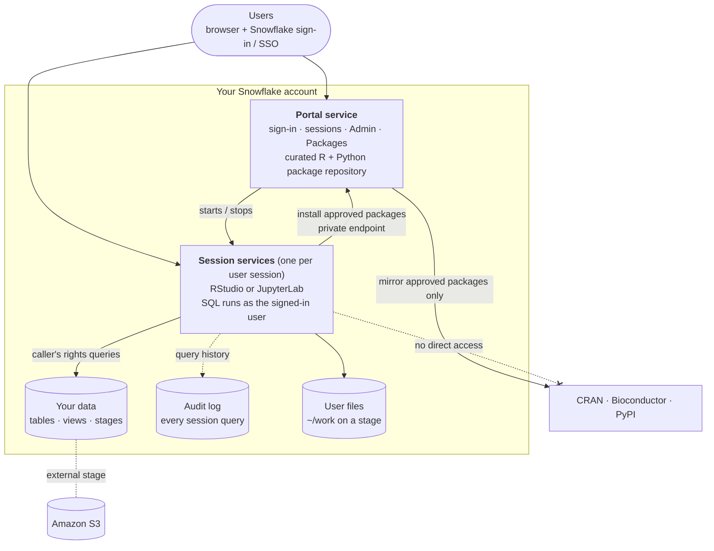

# SPCS Workbench

**Multi-user RStudio and JupyterLab that runs entirely inside your Snowflake account.**

SPCS Workbench gives data scientists and researchers browser-based RStudio and JupyterLab sessions on [Snowpark Container Services](https://docs.snowflake.com/en/developer-guide/snowpark-container-services/overview) (SPCS). Users sign in with their normal Snowflake login. Each session queries Snowflake **as that user, under that user's roles**, and draws packages from a repository curated by admins. Every query is audited.

There are no servers, VMs or Kubernetes clusters to run, and no database passwords or cloud keys in user code.

> **Status:** this is an open-source reference implementation, not an officially supported Snowflake product. Review it, test it in a non-production account first, and adapt it to your own security requirements before you rely on it.

---

## Contents

- [Why use it](#why-use-it)
- [Features](#features)
- [How it works](#how-it-works)
- [Security model](#security-model)
- [Quick start](#quick-start)
- [Documentation](#documentation)
- [Requirements](#requirements)
- [What it costs](#what-it-costs)
- [Limitations](#limitations)
- [Repository layout](#repository-layout)
- [Contributing and support](#contributing-and-support)

---

## Why use it

| Common pain | What the Workbench does instead |
|---|---|
| Analysts copy data out of Snowflake onto laptops or separate servers | Compute runs next to the data, inside the Snowflake account |
| Notebooks contain shared service-account passwords | Each query runs as the signed-in user ([caller's rights](https://docs.snowflake.com/en/developer-guide/snowpark-container-services/tutorials/advanced/tutorial-7-callers-rights)). Grants, masking policies and row access policies apply automatically |
| Anyone can `install.packages()` anything from the internet | Sessions have no route to CRAN, Bioconductor or PyPI. Users install only admin-approved packages and versions |
| Nobody can say who ran what against which data | Every session query is tagged with user, session and IDE, and kept in a permanent audit table |
| A separate identity and permissions system to maintain | Access is ordinary Snowflake roles: grant them to users, or to roles synced from your IdP |

## Features

**For users**
- One portal URL to start, stop and resume personal sessions.
- **RStudio** with R 4.3.3, 4.4.3 or 4.5.1, or **JupyterLab** with Python 3.12.
- A choice of session size and of which of their Snowflake roles the session uses.
- `~/work` is saved to a Snowflake stage, so files survive restarts and are shared across a user's sessions.
- Preconfigured connections: `sf_connect()` in R and the `sfwb` helper in Python. No credentials needed.
- Read files from S3 through Snowflake external stages, with no AWS keys.
- A package catalog: search CRAN, Bioconductor and PyPI, see descriptions, licenses and dependencies, and request a package or a specific version.

**For admins**
- A web **Admin** page for users and access levels, all sessions, settings, the query audit and the admin action log.
- Package approval per version. Approving a package mirrors it and its full dependency tree for every R version and for Python.
- Three access levels (**User**, **Auditor**, **Admin**), implemented as Snowflake roles.
- Idle-session auto-suspend and autoscaling compute pools.
- A one-command install, upgrade and uninstall on macOS, Linux and Windows.

## How it works



1. A user opens the portal and signs in with Snowflake (SSO if configured).
2. They pick an IDE, a size and a role. The portal creates a dedicated SPCS service for that session.
3. Inside the session, every Snowflake query uses the user's own identity and role.
4. Package installs go to the portal's internal repository, which only contains approved packages.
5. An hourly task copies each session's query history into the audit table.

## Security model

- **Identity:** Snowflake authentication only. The app has no user database of its own.
- **Authorization:** two checks must both pass for a query to run. The **user's role** must allow it (normal Snowflake RBAC), and so must the app's **caller grants** (`GRANT CALLER ...`). Caller grants are the upper limit of what the app may do on a user's behalf, and you scope them with `DATA_DATABASES` in `config.env`. See [GRANT CALLER](https://docs.snowflake.com/en/sql-reference/sql/grant-caller).
- **Data protection:** masking policies, row access policies and tags apply exactly as they do in Snowsight or any BI tool.
- **Network:** sessions can reach only the portal and any hosts you list in `SESSION_EGRESS_HOSTS`. The portal can reach only the public package sources through an [external access integration](https://docs.snowflake.com/en/developer-guide/external-network-access/creating-using-external-network-access).
- **Secrets:** none in images or user code. Sessions use short-lived tokens that SPCS provides.
- **Least privilege:** the installer creates a dedicated owner role (`WORKBENCH_OWNER`). ACCOUNTADMIN is used only to run the install and is never the app's runtime role.
- **Audit:** query history per session and user, plus a log of every admin action. Both are kept in Snowflake tables you control.

## Quick start

You need about 15 minutes of hands-on time. The first install then runs unattended for **1 to 2 hours** while it builds and uploads the container images.

```bash
git clone https://github.com/SE-CMCL-EXPLOSION/snowflake-spcs-workbench.git
cd snowflake-spcs-workbench/workbench

snow connection add            # any connection name; its user needs ACCOUNTADMIN
# edit config.env              # at minimum: DATA_DATABASES (and SNOW_CONNECTION if not "default")
./install.sh                   # or: ./install.sh --connection <name>
                               # Windows: powershell -ExecutionPolicy Bypass -File .\install.ps1 [-Connection <name>]
```

The installer finishes by printing the portal URL. Sign in, and you are the first admin. Then grant access under **Admin > Users** and approve packages under **Packages**.

**Full step-by-step instructions, troubleshooting, upgrade and uninstall steps are in [workbench/README.md](workbench/README.md).**

## Documentation

| Document | Read it if you want to |
|---|---|
| [workbench/README.md](workbench/README.md) | Install, upgrade, uninstall, troubleshoot; see what gets created; understand access levels and package curation |
| [workbench/docs/POC_GUIDE.md](workbench/docs/POC_GUIDE.md) | Run an evaluation: setup checklist, admin guide, connecting S3 and preparing data, and a user guide for RStudio and Jupyter |
| [workbench/config.env](workbench/config.env) | See every install setting, each with an explanation |
| [workbench/examples/](workbench/examples/) | Check connectivity from a new session (`snowflake_test.R`, `snowflake_test.py`) |

## Requirements

- A Snowflake account in a region where [Snowpark Container Services](https://docs.snowflake.com/en/developer-guide/snowpark-container-services/overview#available-regions-and-considerations) is available.
- A user who can assume **ACCOUNTADMIN** for the install.
- A macOS, Linux or Windows 10/11 machine with **Docker Desktop** (Linux containers), the **[Snowflake CLI](https://docs.snowflake.com/en/developer-guide/snowflake-cli/installation/installation)**, about 20 GB of free disk and a reasonably fast upload connection. Mac and Linux also need `python3`.

## What it costs

The Workbench uses only Snowflake compute. There is no license fee.

| Component | Default | Notes |
|---|---|---|
| Portal compute pool | 1 × `CPU_X64_XS`, always on | The main fixed cost |
| Session compute pool | `CPU_X64_M`, 1 to `SESSION_POOL_MAX_NODES` (4) | Scales with active sessions; idle sessions suspend after 4 hours (configurable) |
| Warehouse | `WORKBENCH_WH`, X-Small, auto-suspend | App metadata queries and the hourly audit task. User queries run on the users' own warehouses |
| Storage | Images, user files, package mirror, audit tables | Standard Snowflake storage rates |

See [Snowpark Container Services costs](https://docs.snowflake.com/en/developer-guide/snowpark-container-services/accounts-orgs-usage-views). You can track spend with the [SNOWPARK_CONTAINER_SERVICES_HISTORY](https://docs.snowflake.com/en/sql-reference/account-usage/snowpark_container_services_history) view.

## Limitations

- **IDEs:** RStudio and JupyterLab only.
- **Second sign-in:** each session has its own URL and needs one sign-in, which is silent with SSO. SPCS caller tokens are only valid in the service that received them.
- **OS libraries:** R packages that need extra system libraries (for example `sf` needs GDAL) install but won't load until those libraries are added to the image.
- **Bioconductor versions** are fixed per Bioconductor release, so they can't be pinned individually.
- **GPU sessions** aren't configured out of the box.
- **Single account:** each Snowflake account needs its own install.

## Repository layout

```
workbench/
├── config.env                 # the only file you edit
├── install.sh / install.ps1   # install or upgrade (macOS·Linux / Windows)
├── uninstall.sh / .ps1        # remove (keeps user files unless --purge)
├── prereqs.sql … portal.sql   # SQL run by the installer, templated from config.env
├── portal/                    # portal web app + package repository (Python)
├── images/                    # RStudio, JupyterLab and shared session images
├── examples/                  # connection smoke tests
└── docs/POC_GUIDE.md          # evaluation and operations guide
```

## Contributing and support

Issues and pull requests are welcome. Please don't include account identifiers, user names or data in issues.

This project is provided as is, without warranty or official Snowflake support. For help with Snowflake itself (SPCS, roles, integrations), see the [Snowflake documentation](https://docs.snowflake.com/) or contact your Snowflake account team.
